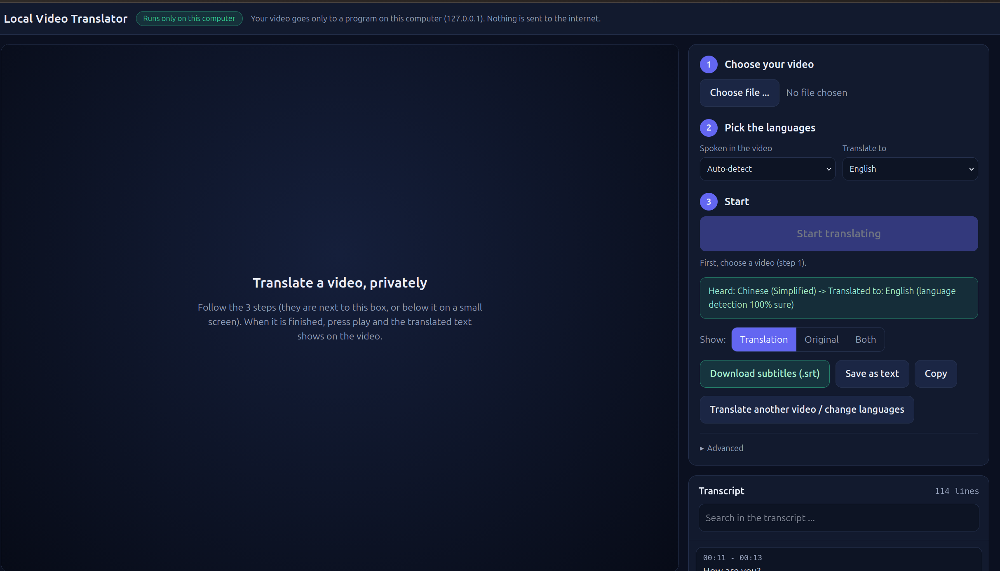

# Local Video Translator

Translate the speech in any video into another language, **fully on your own computer**.

You choose a video in a web page, pick the language you want, and press one button.
The program finds the spoken language by itself, writes down what was said, translates it,
and shows the translated text on the video together with the full transcript.
You can also download the subtitles as an `.srt` file.




---

## What you get

- **Any language to any language.** About 95 spoken languages are recognised, and the text can be translated into about 96 languages.
- **Automatic language detection.** You only choose the language you want to read.
- **Upload in the page.** No need to type file paths.
- **Subtitles on the video** (works in fullscreen) and a **clickable transcript**: click a line to jump to that moment.
- **Show Translation, Original, or Both.**
- **Download `.srt`** subtitles, or save/copy the text.
- **Private.** After the one-time setup it works without internet (see [Privacy and security](#privacy-and-security)).

## How it works

```
Your video  ->  Whisper large-v3  ->  text in the spoken language
                (listens, finds the language)
            ->  NLLB-200           ->  text in the language you picked
                (translates)
            ->  shown in the page, ready to download as .srt
```

| Step | Model | Made by |
|---|---|---|
| Listening | Whisper `large-v3` (through `faster-whisper`) | OpenAI |
| Translating | NLLB-200 distilled (`1.3B`, or `600M` if that is all you downloaded) | Meta |

---

## Before you start

| You need | Notes |
|---|---|
| Ubuntu or another Linux | These steps are written for Ubuntu. |
| Internet **only for the setup** | Needed once, to install packages and download the models. |
| Free disk space | About **15 GB**: PyTorch with NVIDIA libraries (several GB), Whisper large-v3 (about 3 GB), translator 1.3B (about 5.5 GB). |
| NVIDIA graphics card (recommended) | `large-v3` needs roughly 5 GB of graphics memory. With a smaller card, use `--whisper medium` (see [Choosing models](#choosing-models)). Without an NVIDIA card it still works on the CPU, but much slower. |
| Python **3.12** | The steps below install it for this project only. Newer versions (like 3.14) may not have ready-made packages yet. |
| A normal browser | Chrome or Edge (tested). Firefox should work but has not been tested. |

---

## Setup (do this once)

Open a terminal **inside the project folder** (the folder that contains `app.py`).

### 1. Install `uv` (a tool that manages Python and packages)

```bash
curl -LsSf https://astral.sh/uv/install.sh | sh
source ~/.bashrc
```

If `uv` is still not found, close the terminal and open a new one.

### 2. Create a private Python 3.12 environment

```bash
uv venv --python 3.12
source .venv/bin/activate
python --version        # must say Python 3.12.x
```

`uv` downloads Python 3.12 for this folder only. Your system Python is not changed.
You will see `(Video_Translator)` (or similar) at the start of the terminal line when the environment is active.

### 3. Install PyTorch

Choose **one** command:

```bash
# NVIDIA graphics card (also needed for RTX 50-series cards)
UV_HTTP_TIMEOUT=600 uv pip install torch --index-url https://download.pytorch.org/whl/cu128

# No NVIDIA card (CPU only, slower)
uv pip install torch --index-url https://download.pytorch.org/whl/cpu
```

The NVIDIA download is large. If it stops with a *timeout* error, simply run the same command again.

### 4. Install the other packages

```bash
uv pip install -r requirements.txt
```

Always use `uv pip` (not plain `pip`) so everything goes into this environment.

### 5. Install ffmpeg (reads the sound from video files)

```bash
sudo apt install ffmpeg
```

### 6. Download the models (needs internet, once)

```bash
python download_models.py --translator 1.3b
```

This saves the models in the `models/` folder (about 8.5 GB). When it finishes, **you can turn the internet off**.
It is safe to run again: files that are already complete are skipped.

---

## Using the app

### Start it

```bash
python app.py
```

The terminal prints a link like this:

```
Open this link in your browser:

  http://127.0.0.1:8765/?token=...long-secret-text...
```

Open that link in your browser. **Keep the terminal open** while you use the app.
The token changes every time you start the app, so always use the newest link.
Don't share the link.

### In the page

1. **Choose your video.** Click *Choose file ...* and pick a video or audio file.
2. **Pick the languages.**
   - *Spoken in the video*: leave it on **Auto-detect**, or choose the language yourself.
   - *Translate to*: the language you want to read (English is the default).
3. **Press *Start translating*.** A progress bar shows the two steps (listening, then translating).
   Long videos take a while. You can press *Cancel* at any time.

When it is done, press play on the video: the translated text appears as subtitles.
On the right you can:

- switch between **Translation / Original / Both**,
- **Download subtitles (.srt)** (it saves what you are currently showing),
- **Save as text** or **Copy** the transcript,
- search the transcript and click any line to jump to it,
- press *Translate another video / change languages* to start again.


### Stop it

Press **Ctrl+C** in the terminal. The temporary files are deleted.

### Next time you want to use it

You do **not** repeat the setup. Just:

```bash
cd path/to/Video_Translator
source .venv/bin/activate
python app.py
```

---
